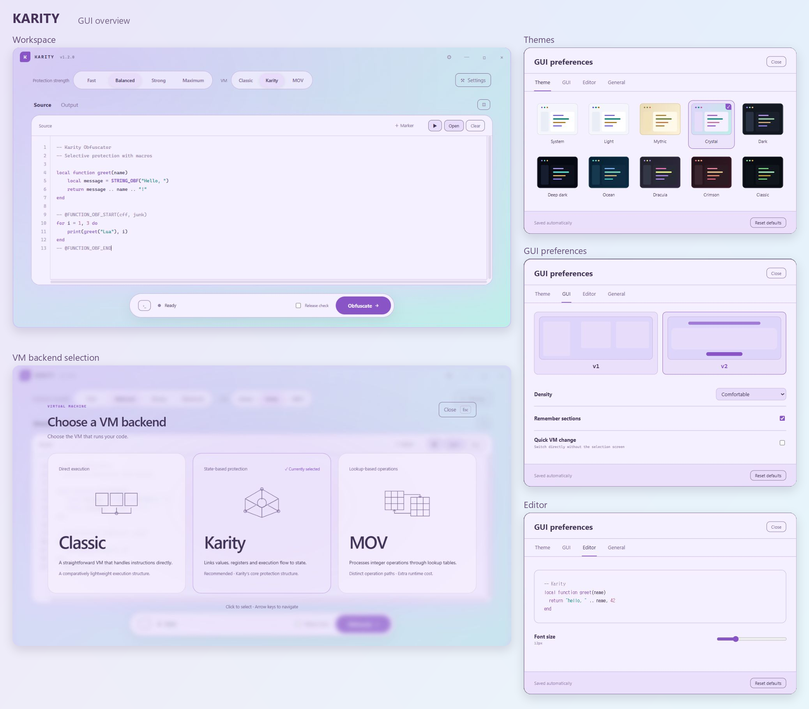

# Karity Obfuscator

A Lua 5.3 obfuscator with a GUI, selective source protection, and three VM
backends: **Karity**, **Classic**, and **MOV**.

## Quick start

Requires **Python 3.12+**. Python 3.15 uses lazy imports to defer heavy processing
modules until needed, keeping startup lighter. Python 3.12–3.14 remain supported.

```sh
python -m pip install -r requirements.txt
python obfuscator_gui.py
```

1. Open a Lua file or paste your code.
2. Choose a protection preset and VM backend. **Balanced + Karity** is a starting point.
3. Click **Obfuscate**, then copy or save the result.

Windows includes Lua tools in `bin/`. On other platforms, install matching
Lua 5.3 and `luac` 5.3 tools and make them available on `PATH`.



## Protection presets

| Preset | Use |
|---|---|
| **Fast · 빠르게** | Lightweight VM protection; use markers for heavy source passes. |
| **Balanced · 균형** | More VM diversity with light source transformations. |
| **Strong · 강하게** | Full source protection, including StringObf and CFF. |
| **Maximum · 최대** | Larger protection budgets, more VM variants, and packing. |

Every preset keeps NumberObf and MemeStrings on the VM output. Preset and
backend selections are independent; advanced settings let you customize either.
Stronger presets increase build time, output size, and runtime cost.

Use **＋ Marker** to select sensitive code, VM regions, or exclusions. Run the
source with **F5** or the result with **Shift+F5**. See the
[selective protection guide](docs/selective-obfuscation.md) for marker usage.

## CLI and JSON

The CLI remains available for scripts and automated builds:

```sh
python main.py input.lua -o protected.lua -c config.example.json --profile builtin:balanced
python main.py input.lua -c obf_gui_config.json
```

GUI-saved configurations also work with the CLI. Existing `dev`, `fast-vm`,
`high`, and `max` JSON profiles retain their original meanings; `dev` is for
development and diagnostics. See [user presets](docs/user-presets.md) and the
[configuration reference](docs/configuration.md).

## Documentation

- [Presets and backend selection](docs/user-presets.md)
- [Configuration reference](docs/configuration.md)
- [Selective protection](docs/selective-obfuscation.md)
- [Backend architecture and supported options](docs/backends.md)
- [Lua targets and compatibility](docs/lua-targets.md)
- [Preset performance measurements](docs/performance/user-presets.md)

Pass guides: [Strings](docs/passes/stringObfuscation.md),
[Functions](docs/passes/functionObfuscation.md),
[Global localization](docs/passes/localizeGlobals.md),
[Packer](docs/passes/packer.md), and [Anti-debug](docs/passes/antiDebug.md).

## Examples

- Hello: [source](examples/hello.lua), [protected output](examples/hello.protected.lua), [comparison](images/1.png).
- Selective protection: [source](examples/selective.lua), [protected output](examples/selective.protected.lua).

## Testing

```sh
python -m pip install -r requirements-dev.txt
python test/run_ci.py
```

Local verification and CI share the same test manifest. Test protected scripts
in their intended Lua environment before release.

For a larger native/VM differential corpus with saved inputs, options, generated
outputs and per-case differences:

```sh
python tools/explore_vm_semantics.py --seeds 124 7719 20261016 --generated 8 --output local/vm-audit/run
python tools/explore_vm_semantics.py --inputs my-script.lua --versions 5.3 --generated 0 --output local/vm-audit/my-script
```

Generated programs and boundary fixtures run on both Lua versions and all three
backends with fresh runtime processes and execution timeouts. The corpus tests
finite cases; matching output does not establish complete semantic equivalence.
Use `--harness test/fixtures/vm_chunk_interface_harness.lua` with the matching
`vm_chunk_interface.lua` input to observe chunk returns, environments and
`require`. Add `--pack --versions 5.3` to include the packer boundary.

## License

[MIT License](LICENSE). Use only on code you own or are authorized to protect.
