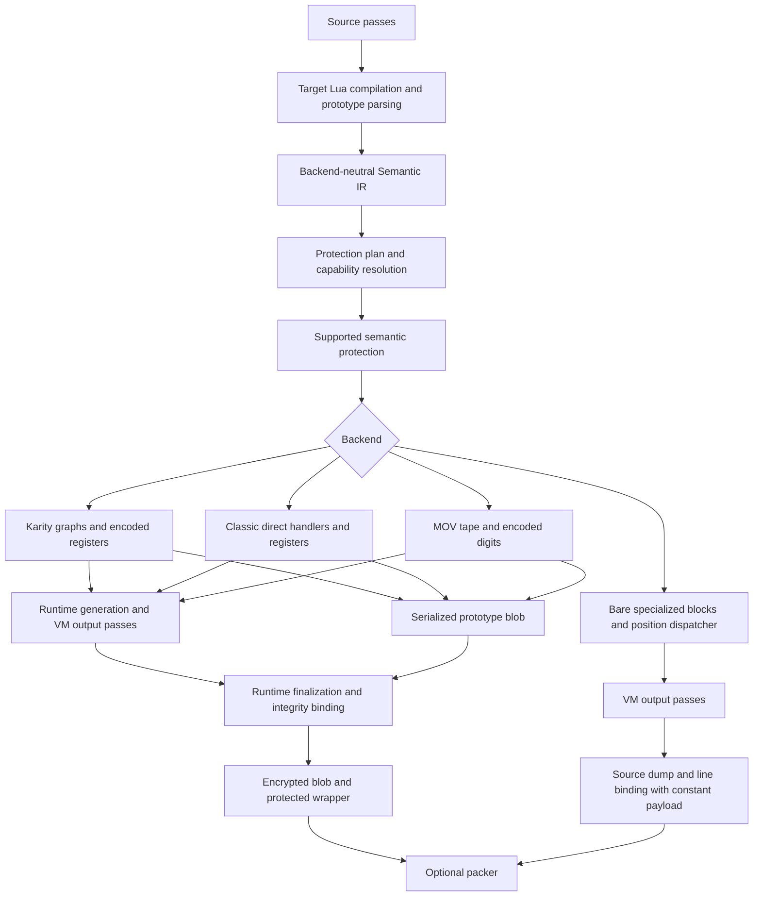
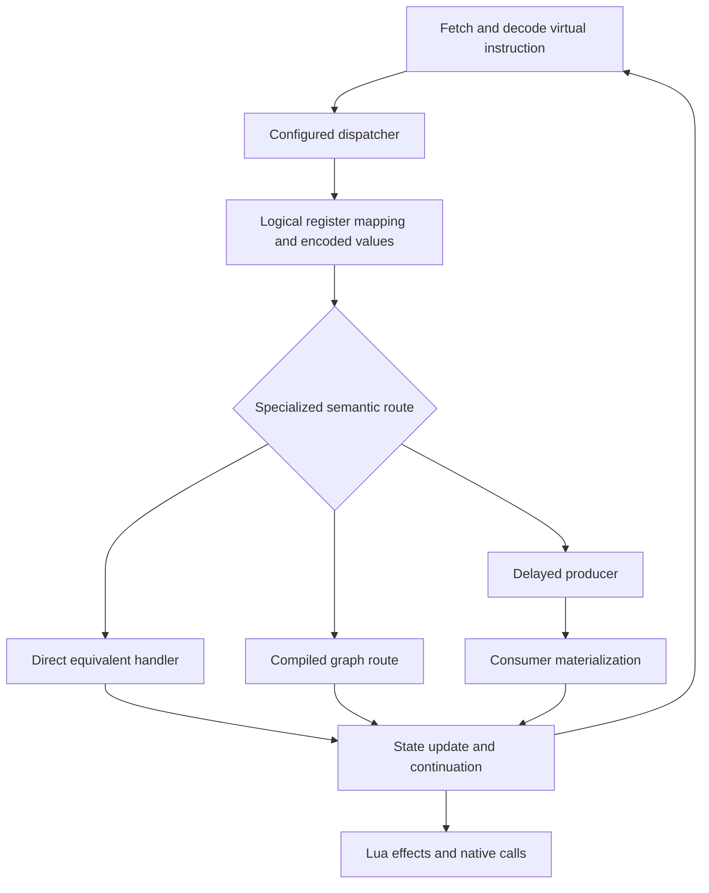
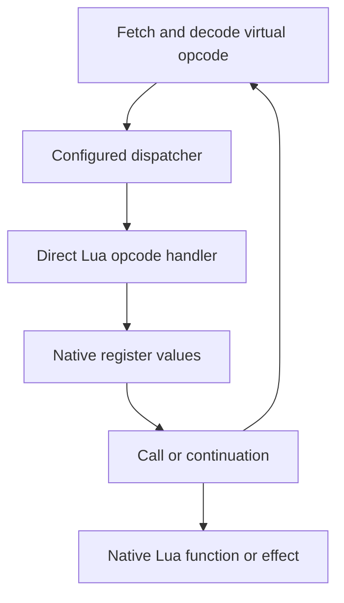
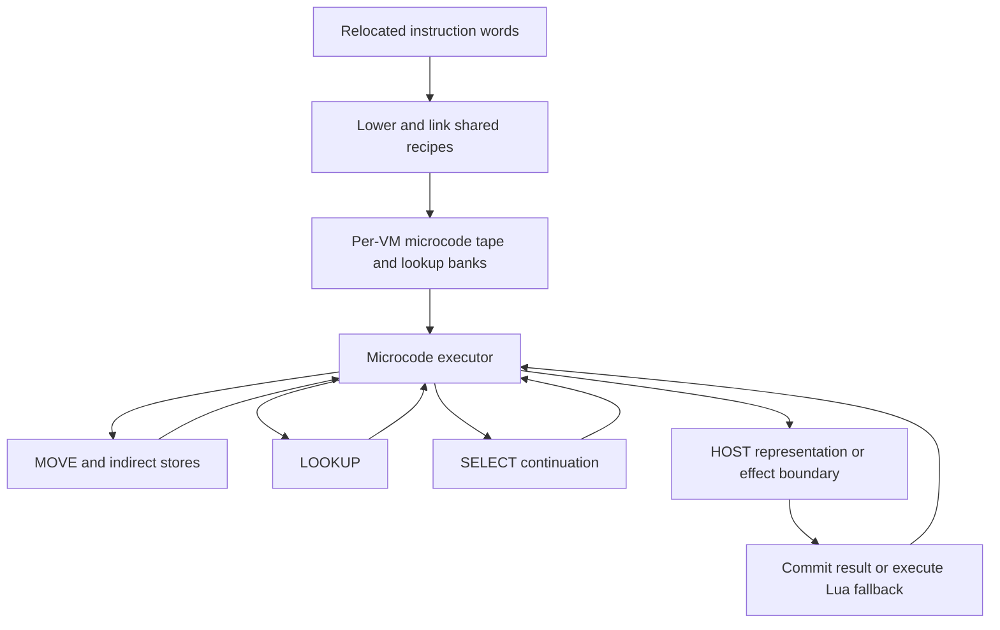

# VM backends

Karity, Classic, MOV and Bare consume common Lua 5.1/5.3 semantic IR and produce
executable Lua source. Select `--vm-option backend=karity|classic|mov|bare` or use the GUI.
An omitted backend and `backend=default` both select Karity. **Migration:** older
versions mapped `default` to Classic; specify `classic` to retain that behavior.
MOV is a supported release configuration with documented HOST boundaries; it is
not yet a complete MOV-only implementation.

## Shared pipeline and interface

`VMPass(vm_options=...)` normalizes the backend and delegates to `VMBuildPipeline`.
Its `run(script)` returns protected Lua; `last_profile` reports build phases.
All backends share compilation, prototype parsing, Semantic IR construction,
optimization, protection planning and configured output passes. Blob runtimes
also share VM assignment, integrity constants and encrypted blob forms.
The backend declares its
capabilities and selects instruction lowering and runtime generation. Packing is
a separate outer pass and also works without a VM. See the
[IR architecture and migration map](vm-ir-architecture.md).
Shared blob layout and measured storage costs are described in the
[compact prototype storage report](performance/serialization.md).

For blob runtimes, VM output passes run before dump/integrity binding.
Changing that finalized function afterwards can invalidate the artifact. Each
prototype belongs to one generated VM; increasing `vm_count` diversifies runtimes,
not CPU parallelism. Source/output pass contexts and release rules are listed in
the [configuration reference](configuration.md).

## Karity

See [runtime hardening](runtime-hardening.md) for per-constant storage, protected
string values and repeated host checks.

Karity supports graph execution, state threading, argument/upvalue/table/branch
virtualization, runtime polymorphism and helper diversity. Which routes actually
run depends on the enabled controls and eligible sites. Heavy graphs are compiled
at build time and selected sparsely at runtime. This backend still depends on Lua
for native calls and observable effects; it is not an isolation boundary.

## Classic

Classic retains opcode mapping, split/fused handlers, handler mutation and
configurable dispatchers on the shared packaging pipeline. It omits Karity's
encoded-register/graph execution and deferred producers. Direct arithmetic,
comparisons and object operations remain visible in host Lua handlers. It is a
useful simpler runtime for comparison and debugging, with fewer runtime layers.

## Bare

Bare lowers the shared semantic instructions into program-specific Lua operations
over generated registers and captured cells. This is a separate virtualization
backend, not a source-pass shortcut: it consumes the same optimized/protected IR,
including supported IR morphing and junk insertion.

Control flow uses program-specific blocks selected by a randomized position
variable. Short straight-line regions stay together; long regions are split at
16–32 semantic emission units, keeping each protection call atomic. Random IDs and
threshold branches place them in a binary decision tree. Leaves contain emitted
Lua operations rather than opcode handlers. This runs on both Lua 5.1 and 5.3,
including irreducible input CFGs on Lua 5.3, without emitted `goto` statements.
Numeric-loop coercion and bounds use the existing Classic conversion helper.
Only helpers required by the input are emitted. There is no instruction blob,
reader or opcode interpreter. Output passes still apply; the generated dispatcher
has the common marker that excludes it from redundant generic CFF.

Bare compiles guard decisions and guest protection boundaries into semantic IR.
Small groups of guard/constant/write IR instructions emit as one direct call,
preserving their logical protection events without extra register-copy dispatch.
Repeated host walks and constant recovery use shared native helpers. The emitter
selects string recovery, authorized writes, environment access, script getters,
tailcall support and numeric-loop helpers according to actual use. Loop helpers
are shared across functions, and native APIs use one numeric capture bank with
random slots and own-field reads where available.

The existing shared line-state implementation supplies three to five dispersed
native faults with randomized slots and three independent reader families.
A dump CRC binds the final function after output transforms. Encoded strings
and selected integer constants live in a compact external constant pool keyed
by that state, without an instruction blob. The pool uses a per-build printable
alphabet, randomized tags and masked record offsets, instead of per-constant
escaped-string tables. Constants are deduplicated across functions. Numeric
encoding follows `integrity_constants` and `integrity_constant_rate`; strings
and a sentinel retain identity binding even when numeric encoding is disabled.
`environment_policy` and shared repeated host checks are supported.
Native helpers for inspection, recovery, source readers, dump normalization,
CRC and call boundaries remain outside the protection IR; the guard's fail/
continue branch stays in IR. Debug/dump capabilities and a compatible
runtime dump ABI are required, as with the other protected backends.

There is no generic instruction executor, but the protection package adds a
substantial fixed size and startup cost to small inputs. Operation semantics
remain visible before output passes. Closures, nil-bearing open results
and register lifetimes use the shared IR analysis. Lua 5.1 environment changes
apply to the actual generated closure. Selective VM boundaries retain the common
pipeline's Lua 5.3 restriction. CE image-backed constants are unsupported.
Native Lua local-variable limits still apply to generated functions.
Source pre-passes still expand into executable blocks, and each guest function
retains its own closure/frame support. Input shape and settings can therefore
make Bare larger than an opcode-blob backend. Encoding/encryption alone is not
compression. See the [size measurements and Prometheus comparison](performance/bare-size.md).

`KARITY_GET_VM_COUNT()`/`KARITY_GET_VM_ID()` return 1/0. With no serialized runtime,
the script getter returns the dump/line identity state, the layout getter identifies
the semantic IR generation and code length counts semantic instructions in the
current function, including inserted guards. Abort/assert remain catchable;
panic invalidates the generated chunk instance, including suspended callbacks.

Bare bounds output literal expansion by default to one hot or three cold
operations per literal, preventing the added guard IR from multiplying into
oversized native functions. Explicit `literal_mosaic.output_cost` overrides this
default. Packing preserves the finalized self-bound function and forwards only
the original chunk arguments to the guest.

Backend registry metadata keeps persisted IDs separate from display names and
descriptions so future naming changes do not require rewriting stored settings.

## MOV

Each VM has independent micro-op IDs and digit encodings. Integer arithmetic,
floor division/modulo, bitwise operations and signed-count shifts use lookup
recipes. Numeric comparisons cover integer/float combinations; float negation
flips the sign through lookup. String length and all-string concatenation use
byte lists. String equality is locale independent; byte ordering is lowered only
under C/POSIX collation. Boolean tests and jumps select microcode continuations.

Encoded integers and strings can remain in registers until a native consumer
needs their Lua representation. HOST preparation/commit includes classification,
bitcasts and representation construction. Binary floating-point arithmetic,
coercions, metamethods, non-C string ordering and object/call semantics still use
Lua execution. Function-table indirection alone is not counted as MOV lowering.
Recipes are shared per VM; frames keep private scratch storage and continuations.
See the [detailed supported operations](configuration.md#vm) and implementation
in [mov](../obfuscator/vm/mov/).

## Supported controls

The table below is generated from `VM_OPTION_DOCS` and the same capability map
used by the GUI, CLI warnings and MOV profiling. ?No? means retained but ignored;
invalid option names, types and ranges remain validation errors. GUI controls
are disabled without discarding stored values. CLI warns once for supplied
unsupported controls, including values inherited from a profile.

<!-- BEGIN BACKEND OPTIONS -->

| Option | Karity | Classic | MOV | Bare |
|---|---|---|---|---|
| `opcode_synthesis` | Yes | Yes | Yes | No |
| `synthesis_policy` | Yes | Yes | Yes | No |
| `synthesis_max_code_growth` | Yes | Yes | Yes | No |
| `synthesis_max_steps` | Yes | Yes | Yes | No |
| `synthesis_max_recipes` | Yes | Yes | Yes | No |
| `synthesis_max_occurrences` | Yes | Yes | Yes | No |
| `opcode_splitting` | Yes | Yes | No | No |
| `opcode_fusion` | Yes | Yes | No | No |
| `ir_mba_rate` | Yes | Yes | Yes | Yes |
| `ir_test_set_rate` | Yes | Yes | Yes | Yes |
| `ir_tail_duplication_rate` | Yes | Yes | Yes | Yes |
| `ir_rematerialization_rate` | Yes | Yes | Yes | Yes |
| `ir_morph_max_growth` | Yes | Yes | Yes | Yes |
| `ir_morph_max_added_instructions` | Yes | Yes | Yes | Yes |
| `ir_morph_max_added_blocks` | Yes | Yes | Yes | Yes |
| `ir_morph_max_transforms` | Yes | Yes | Yes | Yes |
| `ir_morph_max_depth` | Yes | Yes | Yes | Yes |
| `ir_morph_pass_max_added_instructions` | Yes | Yes | Yes | Yes |
| `ir_morph_max_new_operations` | Yes | Yes | Yes | Yes |
| `physical_block_permutation_rate` | Yes | Yes | No | No |
| `physical_block_permutation_max_jumps` | Yes | Yes | No | No |
| `state_dependency_limit` | Yes | No | No | No |
| `requirements` | Yes | Yes | Yes | Yes |
| `backend` | Yes | Yes | Yes | Yes |
| `dispatcher_type` | Yes | Yes | No | No |
| `dispatcher_target_hiding` | Yes | Yes | No | No |
| `semantic_state_threading` | Yes | No | No | No |
| `argument_virtualization` | Yes | No | No | No |
| `upvalue_virtualization` | Yes | No | No | No |
| `table_virtualization` | Yes | No | No | No |
| `branch_virtualization` | Yes | No | No | No |
| `blob_form` | Yes | Yes | Yes | No |
| `vm_count` | Yes | Yes | Yes | No |
| `fake_handlers` | Yes | Yes | No | No |
| `mutate_handlers` | Yes | Yes | No | No |
| `junk_instructions` | Yes | Yes | Yes | Yes |
| `junk_rate` | Yes | Yes | Yes | Yes |
| `integrity_constants` | Yes | Yes | Yes | Yes |
| `integrity_constant_rate` | Yes | Yes | Yes | Yes |
| `graph_execution_rate` | Yes | No | No | No |
| `cross_instruction_rate` | Yes | No | No | No |
| `runtime_polymorphism_rate` | Yes | No | No | No |
| `runtime_trace` | Yes | No | No | No |
| `environment_policy` | Yes | Yes | Yes | Yes |
| `block_variant_rate` | Yes | No | No | No |
| `block_variant_count` | Yes | No | No | No |
| `block_variant_max_instructions` | Yes | No | No | No |
| `helper_variant_count` | Yes | No | No | No |
| `helper_diversity_rate` | Yes | No | No | No |
| `semantic_diversity_rate` | Yes | No | No | No |

<!-- END BACKEND OPTIONS -->

## Cost and protection differences

| Backend | Runtime and output cost | Protection characteristics |
|---|---|---|
| Karity | Graphs, variants and encoded state add build, memory and execution cost; rates strongly affect it | Diversified state-dependent routes and representations |
| Classic | Fewer runtime layers; shared output transforms and multiple VMs can still dominate size | Opcode/handler/dispatcher diversification with direct Lua operations |
| MOV | Many microinstructions, lookup banks and byte-list allocations can be expensive; recipes are shared | Encoded data and lookup-based lowered operations, with explicit HOST boundaries |
| Bare | No instruction blob/reader; per-program branches and a fixed protection package add cost | Random block IDs and threshold trees; IR-based host guards and identity-bound constant recovery |

These are architectural trade-offs, not measured speed rankings or security
scores. Compare identical source, passes, seeds and VM counts on the intended
runtime. Use `dev` for a minimal diagnostic build. The balanced `fast-vm` preset
adds source function protection and meme arithmetic; their additional integer
operations also pass through MOV lowering, which can make recursive or repeated
calls substantially more expensive. `high` adds further protection, while
`max` remains an experimental profile. `--release-check` validates the controls
that apply to the chosen backend, not a performance target or resistance proof.

## Verification

Run `python test/run_ci.py`. Backend tests exercise alias resolution, direct
Classic dispatchers, multi-VM execution and MOV lookup paths with native fallback
traps. Independent microcode checks validate shift/division behavior. The suite
also checks trace removal, generated docs, release configuration and packing.
MOV CLI smoke tests retain the call-boundary assertions with short recursive and
tail-call workloads. The backend tests separately execute the original longer
call-machine fixture; this is not a runtime performance target for protected
source functions.
